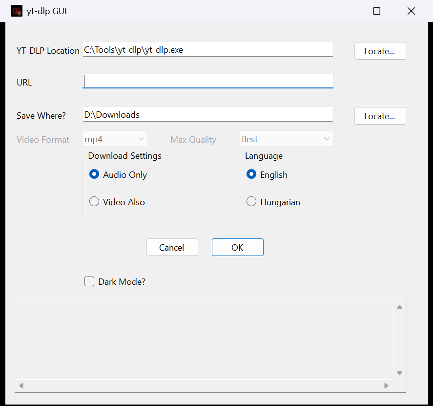

# YtDlpGUI

A small Windows Forms front-end for [yt-dlp](https://github.com/yt-dlp/yt-dlp). Paste a URL, pick a folder, choose audio-only (MP3) or video, and download. yt-dlp's output is shown live in a log box.

## Screenshot



> **Disclaimer:** This project is an independent, unofficial tool. It is not endorsed by, affiliated with, or sponsored by yt-dlp or YouTube. "YouTube" is a trademark of Google LLC. You are responsible for making sure your downloads comply with the terms of service of the sites you use and with applicable copyright law.

## Requirements

- Windows x64 and the .NET 10 SDK (to build). The published exe needs no .NET runtime.
- `yt-dlp.exe`: put it next to `YtDlpGUI.exe`, put it on `PATH`, or browse to it in the app
- `ffmpeg.exe` (for **Audio Only** MP3 conversion and for merging separate video and audio streams): next to `yt-dlp.exe` or on `PATH`. The app warns if it can't find it.

## Build and run

```
dotnet build YtDlpGUI.csproj
dotnet run --project YtDlpGUI.csproj
```

A Release build (`dotnet build -c Release`, or Build in Visual Studio with the Release configuration) also publishes a single self-contained `YtDlpGUI.exe` (about 50 MB, no .NET runtime needed) to `%LOCALAPPDATA%\build\YtDlpGUI\bin\Release\net10.0-windows\win-x64\publish\`. `dotnet publish -c Release` produces the same file.

**Why is the exe about 50 MB for such a small app?** The app's own code is only about 160 KB. The rest is the .NET runtime and the Windows Forms libraries, bundled into the exe (and compressed) so you don't have to install .NET first. Nothing else is hidden in there. If you'd rather have a tiny exe, switch the csproj to a framework-dependent publish (`<SelfContained>false</SelfContained>`). It then needs the .NET 10 Desktop Runtime installed.

Build output goes to `%LOCALAPPDATA%\build\YtDlpGUI\{bin,obj}\` (see `Directory.Build.props`) rather than the project folder, because the sources live on Google Drive.

## Usage

1. Check the yt-dlp location (auto-detected from the saved setting, the app folder, then `PATH`).
2. Enter an `http(s)` URL and the save folder (created if missing).
3. Choose **Audio Only** (MP3) or **Video Also**. For video, pick a container (mp4, mkv, webm) and a maximum quality (Best, or 2160p down to 360p) and press **OK**. Only the single video is downloaded, never the whole playlist.
4. **Cancel** stops a running download. When nothing is running it closes the app.

The **About** button shows the version, build number, license and project links. The version is `1.0.<build>`, where the build number is the number of days since 1 January 2000 on the day it was built (for example, build 9794 is 25 October 2026).

Settings are stored in `%LOCALAPPDATA%\YtDlpGUI\settings.json`: yt-dlp path, save folder, language, dark mode, audio/video mode, video format and quality, and window position and size. They are saved when you start a download and when the window closes. Language and dark mode are also saved as soon as you change them. Delete the file to reset everything. Language changes apply immediately. Dark mode applies after a restart.

Video quality is a cap: `Best` takes the highest available, otherwise the best stream at or below the chosen height. mp4 and webm prefer streams that already fit the container. If the video has no such streams at that quality, yt-dlp may fail to merge. Use mkv, which accepts anything.

## Localisation

The UI is available in English (default) and Hungarian. Control text is looked up in `Resources.resx` / `Resources.hu.resx` by the control's `Name`. See `CLAUDE.md` for the details.

## Changelog

See [CHANGELOG.md](CHANGELOG.md).

## License

[MIT](LICENSE)
